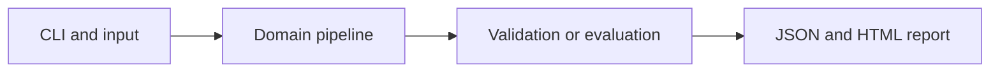

# Neural Image Pattern Classifier

Train a two-layer neural network with backpropagation to recognize noisy geometric image patterns.

**Category:** Deep Learning

**Execution:** Actual local algorithm or workflow; no external model service required.

## Run

```sh
python -m venv .venv
# Windows: .venv\Scripts\activate
# macOS/Linux: source .venv/bin/activate
python -m pip install -r requirements.txt
python app.py
python -m unittest discover -v
```

Open `results/report.html` after running. Python 3.10+ is required. Use `--help` for input and seed options.

## Architecture



## Algorithm

An 8x8 image is flattened into 64 features, projected through a 24-unit tanh hidden layer, and classified with softmax. Minimize cross entropy using full-batch gradient descent.

## Evaluation

Generate independent training and test noise around vertical, horizontal and diagonal patterns. Compare test accuracy with a training-majority baseline and inspect a numerical gradient check.

## Limitations

This is an MLP on simple synthetic images, not a CNN, natural-image benchmark or pretrained vision model.

## Documentation

- [PDF project guide](PROJECT_GUIDE.pdf)
- [Editable guide](GUIDE.md)
- [Model and system card](MODEL_CARD.md)
- [Measured results](results/metrics.json)
- [Test output](TEST_RESULTS.txt)

## Extend it

Add rotated shapes and unseen translations, mini-batching, checkpoints, confusion matrices and a comparison with a convolutional model.

AI-assisted educational project with synthetic data. Review, customize and explain your own contribution accurately. MIT license.
